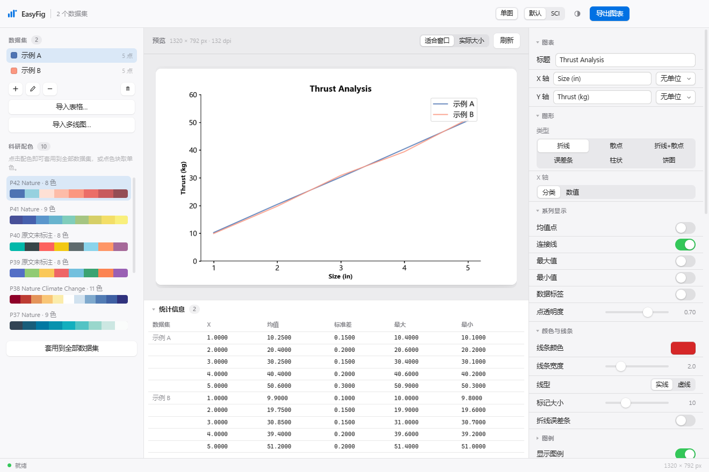
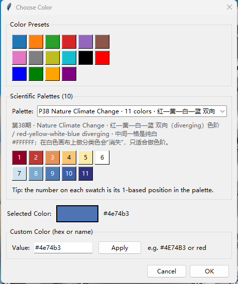

# EasyFig

EasyFig turns measurement tables into publication-ready charts. It is an
**Electron desktop app** with an Apple-style interface, driven by a Python
rendering core:

* the **Electron app** (the app proper) owns the window, the interface and the
  native menus;
* a **Python engine** (`easyfig`) does the parsing, statistics and matplotlib
  rendering;
* a **command line interface** exposes the same engine for scripts and CI.

Both front ends render through `easyfig/chart_builder.py`, so a chart produced
on the command line is identical to the one in the preview window.

It also bundles **ten published journal colour palettes** (Nature / Science,
2020-2022) that are directly selectable in the colour picker and from the CLI.



## Architecture

```
+---------------------------- Electron (Node) ----------------------------+
|  main.js          window, platform chrome, native dialogs, menu         |
|  preload.js       contextBridge: the only API the page can see          |
|  renderer/        Apple-style interface (HTML/CSS/JS)                   |
|  python-bridge.js owns the engine process, correlates requests          |
+---------------------------------+---------------------------------------+
                    line-delimited JSON over stdio
+---------------------------------+---------------------------------------+
|  easyfig/bridge.py         render / export / import / schema            |
|  easyfig/chart_builder.py  settings + headless rendering                |
|  easyfig/chart_manager.py  matplotlib drawing (incl. broken axes)       |
|  easyfig/data_processor.py parsing, statistics, fitting                 |
|  easyfig/palettes.py       ten scientific palettes                      |
+-------------------------------------------------------------------------+
```

The renderer never touches Node or the filesystem: everything goes through the
handful of functions in `preload.js`. The page runs under a strict CSP
(`default-src 'none'`, no inline scripts, no remote assets).

## Install

```powershell
# 1. Python side (chart engine)
.\.conda-env\python.exe -m pip install -e .

# 2. Electron side (interface)
npm install
```

`npm install` downloads Electron (about 380 MB into `node_modules`); it is not
committed. Everything else works offline.

Requirements: Python 3.10+ with `numpy`, `matplotlib`, `pandas`, `openpyxl`
(a `.conda-env` is materialised in the repo) and Node.js 20+.

## Run

```powershell
npm start                 # the app
npm run smoke             # self-test: render + screenshot, then exit
npm run shot              # same, writes electron/.smoke/shot.png
```

`npm run smoke` starts the engine, waits for the first figure, screenshots the
window to `electron/.smoke/shot.png` and exits - that is how the screenshot above
is produced, and how the app is verified without a human.

The Python engine is located in this order, so the app works from a checkout,
from a packaged build, or with any interpreter you point it at:

1. `$EASYFIG_PYTHON`
2. `resources/python/` (packaged builds)
3. `.conda-env` / `.venv` next to the app
4. `python3` / `python` on `PATH`

If none is found the interface shows an actionable message instead of failing
silently.

## The interface

The layout follows the macOS conventions: a translucent sidebar, a content
stage, an inspector on the right and a status bar.

| Region | Contents |
| --- | --- |
| Title bar | app mark, dataset count, **单图 / 拼图** mode switch, visual preset, appearance toggle, **导出图表 / 导出拼图** |
| Sidebar | dataset source list, import buttons, and the ten scientific palettes as swatch strips |
| Stage | zoom controls, the figure card, and a collapsible statistics table |
| Inspector | grouped settings in System-Settings rows: in 单图 mode 图表 / 图形 / 系列显示 / 颜色与线条 / 误差条 / 图例 / 数据处理 / 坐标轴与刻度 / 断轴 / 导出; in 拼图 mode 排版 / 面板标记 / 字体统一 / 面板 / 导出 first, then the same style groups |
| Status bar | engine status dot and the exact pixel size of the preview |

Apple-style details: an SF-style type ramp, iOS switches, segmented controls,
pop-up buttons, sliders with value readouts, colour wells, spring easing
(`cubic-bezier(0.32, 0.72, 0, 1)`), translucent materials via `backdrop-filter`,
0.5px hairlines, light/dark appearance following the system, and
`prefers-reduced-motion` support.

Keyboard: `Cmd/Ctrl+O` import table, `Shift+Cmd/Ctrl+O` import multi-line,
`Cmd/Ctrl+S` export, `Cmd/Ctrl+R` refresh, `Esc` close a popover or sheet.

The interface remembers your settings, datasets, appearance and compose layout
between launches (localStorage, capped so a huge dataset never breaks startup).

### Colour picker

Every colour well opens a popover with the 16 quick-pick colours, the ten
scientific palettes (numbered swatches, whose number is the palette position)
and a free-form hex/name field. The sidebar's palette strips apply a whole
palette to every dataset at once.



## Command line

The CLI stays available for scripting and does not need Electron:

```powershell
easyfig plot --table results.csv --time-column Size -o chart.png
easyfig plot --multiline lot1.xlsx lot2.xlsx --merge --fit mean_error -o merged.pdf
easyfig plot --table t.csv --time-column Size --palette akun42_nature -o out.png
easyfig compose --spec figure.json -o figure.png    # multi-panel figure
easyfig layouts                                     # layout presets, as ASCII
easyfig palettes                       # the ten palettes with citations
easyfig options                        # every setting and its default
Get-Content spec.json -Raw | easyfig spec - -o out.svg
easyfig bridge                         # the JSON protocol the app speaks
```

`--json-out` prints a JSON result on stdout (pure ASCII, so pipes are safe);
`--print-settings` dumps the resolved settings without rendering. Exit codes:
`0` success, `1` processing error, `2` usage error.

There is also an `easyfig-gui` command that opens the original Tk interface. It
is kept as a dependency-light fallback (no Node required) and shares the same
engine, so both front ends produce identical figures.

## Composing figures (拼图)

`compose` tiles several charts into one canvas, like a journal figure: each
panel gets an **a / b / c** marker, and one font family plus one set of font
sizes is shared by every panel.

Switch the app to **拼图** in the title bar - the inspector then leads with
排版 / 面板标记 / 字体统一 / 面板 and previews the assembled figure live. The
command line does the same without a window:

```powershell
# one panel per dataset, automatic 2x4 grid for seven series
easyfig compose --table results.csv --time-column Size -o figure.png

# a big left panel with three small ones on the right
easyfig compose --table results.csv --time-column Size --layout big-left-3 -o figure.png

# merge series into panels: panel 1 = A, panel 2 = B and C, panel 3 = the rest
easyfig compose --table results.csv --time-column Size --panels "A;B,C;*" -o figure.png

# write a spec, check the arrangement, then render it
easyfig compose --spec figure.json --print-layout
easyfig compose --spec figure.json -o figure.png
```

`easyfig layouts` lists every preset with a picture of its arrangement:

```
big-top-3  上横跨 + 下三小
  网格 2×3 · 4 个面板
  ┌───────────────────────┐
  │           a           │
  ├───────┬───────┬───────┤
  │   b   │   c   │   d   │
  └───────┴───────┴───────┘
```

### Sizing panels

Layouts are not limited to a uniform grid. Three independent controls decide
how big a panel is:

| Control | Where | Effect |
| --- | --- | --- |
| `row_heights` / `col_widths` | `layout` in a spec, or 每行高度比 / 每列宽度比 | ratio per row/column, so one row or column is taller/wider |
| `rowspan` / `colspan` | per panel | let one chart occupy a 2x2 block while the others stay small |
| `panel_width` / `panel_height` | `compose` | inches per panel cell when the canvas is sized automatically |
| preset | `layout.preset` | a ready-made shape: `1x2`, `2x2`, `big-left-3`, `big-right-2`, `big-top-3`, `big-bottom-2`, `wide-narrow`, `tall-short`, … |

A preset describes a shape for the panel count it was designed for; give it more
panels and it adds rows instead of failing.

### Spec file

`easyfig compose --schema` prints the full schema, including an example. A spec
is one JSON object:

```json
{
  "datasets": [{"name": "Sample A", "sizes": [1, 2, 3],
                "data": [[1.0, 1.1], [2.0, 2.1], [3.0, 3.1]], "color": "#1f77b4"}],
  "layout": {"preset": "big-left-2", "gap_x": 0.22, "gap_y": 0.34},
  "panels": [
    {"datasets": ["Sample A"], "title": "对照组",
     "settings": {"chart_type": "line", "ylabel": "Thrust (kg)"}},
    {"datasets": ["Sample B"], "colspan": 2}
  ],
  "compose": {"label_style": "abc", "font_family": "Times New Roman",
              "tick_label_size": 9, "export_dpi": 300},
  "settings": {"xlabel": "Size (in)", "visual_preset": "sci"}
}
```

* `datasets` is the data; panels reference it by name, so each series is stored
  once.
* `panels` may be omitted, in which case every dataset gets its own panel.
* `settings` is the ordinary single-chart settings table, used as the global
  default for every panel; a panel's own `settings`/`title` override it.
* `layout`, `compose` and `settings` are all optional. Unknown keys are
  rejected, so a typo in a generated spec fails loudly instead of silently.

### Unified typography

`font_family` (Times New Roman, Arial, Helvetica, Calibri, Georgia, 微软雅黑,
黑体, 宋体, or "follow the preset") is applied to every text in the figure -
titles, axis labels, tick labels, legends, data labels, markers and the
whole-figure title - with the installed CJK families kept as fallbacks so
Chinese labels never turn into tofu boxes.

With `unify_font_sizes` on (the default) the five size controls
(`title_font_size`, `axis_label_font_size`, `tick_label_size`,
`legend_font_size`, `data_label_font_size`) override each panel's own sizes, so
seven panels cannot drift apart. Switch it off to let every panel keep the
single-chart settings from the inspector.

Margins and gaps are floors, not exact values: the engine widens them whenever
the chosen font sizes need more room, so enlarging the text never clips a panel
title or a panel marker.

Deliberate limits of a composed figure: a panel never gets a broken axis (a
nested broken-axis grid would fight the outer grid) and a panel legend always
sits inside its cell (the engine's "outside right" placement adjusts the
*figure* margins, which would move every other panel).


Ten palettes transcribed from the Zhihu series 《SCI论文插图经典配色实例》 by
「阿昆的科研日常」 (issues 32, 33 and 35-42; the series has no issue 34) are
built into `easyfig/palettes.py`. Colour values were read from the R/G/B
annotations printed on each card and verified against the card pixels
(error <= 2/255). Each palette keeps its source citation and URL.

| Key | Issue | Journal | Colours | Type |
| --- | --- | --- | --- | --- |
| `akun42_nature` | 42 | Nature | 8 | warm sequential + cool counterpoint |
| `akun41_nature` | 41 | Nature | 9 | blue-green to yellow sequential |
| `akun40_tibet` | 40 | not stated | 8 | high-contrast categorical |
| `akun39_echarts` | 39 | not stated | 8 | general-purpose categorical |
| `akun38_latlf_m` | 38 | Nature Climate Change | 11 | red-yellow-white-blue diverging |
| `akun37_nature` | 37 | Nature | 9 | dark teal to pale teal sequential |
| `akun36_nature` | 36 | Nature | 10 | blue-violet to green sequential |
| `akun35_science` | 35 | Science | 10 | red-cream-blue diverging |
| `akun33_science` | 33 | Science | 10 | orange-red to pale blue diverging |
| `akun32_nature` | 32 | Nature | 9 | blue-white-purple diverging |

> These are the series author's published colour readings, not an official
> journal palette. The citations are transcribed from the card images and were
> not re-verified against the publishers.

From Python:

```python
from easyfig.palettes import PALETTE_ORDER, palette_colors, normalize_color

palette_colors("akun42_nature")        # all 8 colours
palette_colors("akun42_nature", 3)     # evenly sub-sampled to 3
palette_colors("akun32_nature", reverse=True)
normalize_color("4E74B3")              # -> "#4e74b3"
```

Sequential and diverging palettes are ramps: their palest entries
(`#FEE0D5`, `#FFFFFF`, `#FEFDFE`) nearly vanish on a white canvas. For several
categorical series the high-contrast sets (`akun40_tibet`, `akun39_echarts`) or
the darker half of a ramp read better.

## Input formats

**Table** (`.csv`, `.tsv`, `.xlsx`, `.xls`):

| Orientation | Meaning |
| --- | --- |
| `vertical` (default) | each column is one dataset |
| `horizontal` | each row is one dataset, the first cell is its name |

Pick a column as X in the import sheet instead of using the row number; a
millisecond time column is converted to seconds.

**Multi-line** (one file per series): the header row holds the X values and each
column the repeated measurements (vertical), or the first column holds the X
values (horizontal). *Merge* pools measurements that share an X value across all
files, which is what you want for combined error bars or a single fit.

Headers may be plain numbers (`1`, `1.5`) or numbers with a unit suffix
(`1mm`, `24V`). Large `.xlsx` workbooks are streamed with openpyxl so memory
stays bounded. Chinese labels render correctly: `easyfig/fonts.py` prepends an
installed CJK family to matplotlib's font stack.

## Chart options

| Area | Settings |
| --- | --- |
| Chart type | `line`, `scatter`, `line_scatter`, `pie`, `errorbar`, `bar` |
| Axes | x-axis mode, reverse Y, zero start, minor ticks |
| Ticks | X/Y tick counts, auto/custom, rotation, length, width, font sizes |
| Broken axis | Y and/or X break with explicit low/high ranges |
| Series | mean points, connecting line, max, min, data labels |
| Style | visual preset, line colour/width/style, bar colour/style/edge, alpha |
| Error bars | summary or per-size, SD or SEM, capsize, line width, toggles |
| Legend | visibility, position, columns, font and marker size |
| Processing | mean +- SD, linear/polynomial fit, outlier removal, smoothing |
| Export | DPI, size, match-preview or custom, auto crop |

Every setting is listed by `easyfig options` and accepted by `easyfig --set`.

### Broken axes

A broken axis draws the data on two panels, or four when both axes are broken:

```powershell
easyfig plot --table results.csv --time-column Size --xaxis-mode numeric `
    --broken-y --broken-y-low-min 0 --broken-y-low-max 25 `
    --broken-y-high-min 40 --broken-y-high-max 55 -o broken.png
```

The layout follows the two reference recipes rather than an invented one — the
[Matplotlib broken-axis example](https://matplotlib.org/stable/gallery/subplots_axes_and_figures/broken_axis.html)
and the [`brokenaxes`](https://github.com/bendichter/brokenaxes) package:

| Convention | Why |
| --- | --- |
| Panels separated by a small gap (`hspace`/`wspace` 0.05) | two boxes joined by the break, not one continuous frame |
| 45-degree slanted strokes at both ends of every edge facing a join, drawn in figure coordinates | the stroke keeps a true 45-degree angle whatever the panel aspect |
| Inner spines hidden, outer spines kept | the frame opens only where the break is |
| Inner tick marks moved to the panel's outer edge and left unlabelled | otherwise they hang in the gap and read as stray marks |
| One tick interval shared by every panel | a differing step reads as an inconsistent axis |
| The tick landing exactly on the join is dropped | both panels would otherwise label the same spot, on top of each other and on the strokes |
| One centred title and one pair of axis labels for the whole figure | an axes title would sit over a single panel |

A connecting line is broken at the panel edge rather than drawn through it: a
line drawn straight across is clipped and reappears as a short stub that reads as
a measurement. Only the broken directions get a window fixed up front; the other
axis still autoscales. An empty or inverted range disables the break instead of
producing a broken figure, pie charts ignore these options (no cartesian axes),
and composed panels never take a broken axis — a nested grid would fight the
outer one.

## Project layout

```
easyfig/                the Python package: engine, CLI, bridge and Tk fallback
  bridge.py             the JSON protocol
  chart_builder.py      settings + headless rendering
  chart_manager.py      matplotlib drawing, broken axes
  compose.py            multi-panel figures: grids, spans, markers, fonts
  data_processor.py     parsing, statistics, fitting, table loading
  palettes.py           colour helpers + the ten palettes
  fonts.py              CJK font configuration
  cli.py                `easyfig` command line interface
  gui.py, application.py, custom_color_dialog.py, config.py
electron/               the desktop application
  main.js               window, chrome, dialogs, menu, --smoke / --probe
  preload.js            the contextBridge API
  python-bridge.js      engine process + request correlation
  renderer/
    index.html          interface markup
    app.js              state, control wiring, bridge calls
    styles/apple.css    design tokens and components
tests/test_easyfig.py   unit, regression and integration tests
docs/                   screenshots used by this README
examples/               runnable walkthrough: data generator + commands
  make_demo_data.py     writes examples/output/data/*.csv
  output/               generated data and figures (ignored by git)
main.py                 `python main.py` dispatcher (GUI or CLI)
cli.py                  `python cli.py` launcher for an uninstalled checkout
pyproject.toml          Python packaging and the console scripts
package.json            Electron manifest (main + scripts + electron dep)
```

Generated files are never committed: `node_modules/`, `.conda-env/`,
`electron/.smoke/` and `examples/output/` are all ignored, so the repository holds
source and documentation only.

## Development

```powershell
# Python: unit, regression and integration tests (includes a real Node<->Python
# sidecar check, and skips Tk tests when no display is available)
.\.conda-env\python.exe -m unittest discover -s tests -v

# JavaScript syntax
npm run lint:js

# End-to-end app check with a screenshot
npm run shot

# Same, starting in composition mode (writes the same screenshot path)
node_modules\.bin\electron . --smoke --mode=compose --shot electron\.smoke\compose.png

# Layout diagnostics: dumps element geometry as JSON
node_modules\.bin\electron . --probe
```

The suite covers parsing and statistics, table and multi-line importers,
settings validation, all six chart types across a 144-combination sweep,
broken-axis layout, pie-chart and legend regressions, CJK font rendering, figure
export, the ten palettes (values pinned independently of the implementation), the
colour dialog, the Electron-to-Python bridge, packaging metadata, the CLI end to
end, and figure composition (grid shapes, preset spans, panel markers, font
unification, spec files and the compose bridge commands).
